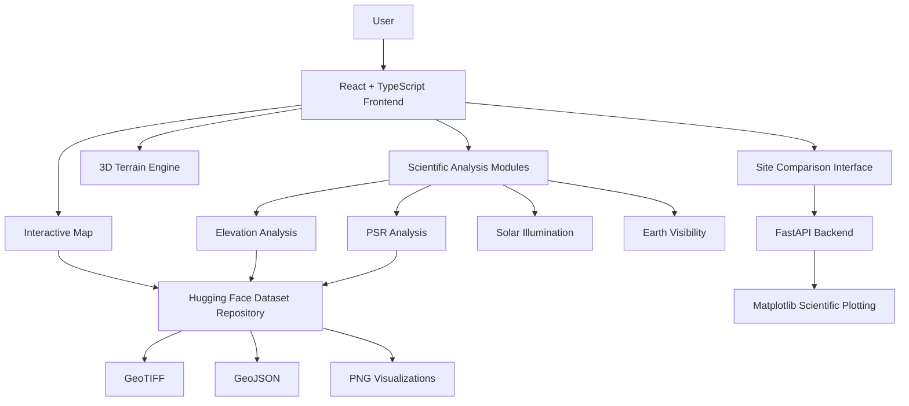

# SOLARIS
### Lunar South Pole Exploration, Scientific Intelligence & Mission Planning Platform

  Explore. Analyze. Evaluate. Prepare for the next frontier.


  An interactive lunar exploration platform designed to help researchers, engineers, students, and mission planners investigate the Moon's south polar region through terrain visualization, scientific datasets, environmental analysis, and preliminary mission-site assessment.

---

## 🌕 1. Overview

**SOLARIS** is an interactive lunar south pole exploration and mission-planning platform focused on understanding the scientific and operational conditions of one of the most important regions of the Moon.

The lunar south pole is a compelling destination for future exploration because of its unusual illumination conditions, permanently shadowed regions, complex terrain, and potential accessibility of water ice and other resources.

However, identifying a promising landing or exploration location requires much more than looking at a lunar image.

Engineers must consider:

- Surface elevation and terrain morphology.
- Local slopes and surface accessibility.
- Solar illumination and lighting conditions.
- Permanently Shadowed Regions (PSRs).
- Earth visibility and communication geometry.
- Potential resource locations.
- Trade-offs between power, communications, and terrain conditions.

SOLARIS brings several of these scientific and engineering considerations together in one interactive environment.

The goal is to make lunar south pole analysis more accessible, visual, and useful for preliminary mission planning.

---

## 🎯 2. Project Objectives

SOLARIS aims to:

1. Provide an interactive map of the lunar south polar region.
2. Enable users to inspect terrain and scientific information at selected locations.
3. Visualize elevation, slope, illumination, and permanently shadowed regions.
4. Investigate potential operational challenges associated with lunar terrain.
5. Examine geometric Earth visibility and solar-power considerations.
6. Compare potential exploration locations.
7. Provide preliminary site suitability assessments using transparent engineering assumptions.
8. Establish a foundation for more advanced lunar mission-planning tools.

---

## 🛰️ 3. Current Features

The following features are implemented in the current project.

### 3.1 Interactive Lunar South Pole Map

Explore the lunar south polar region using an interactive map interface.

Capabilities include:

- Interactive map navigation.
- Zooming and location inspection.
- Lunar terrain visualization.
- Scientific overlay layers.
- Location-based analysis.
- Selection of candidate exploration locations.

### 3.2 High-Resolution Elevation Analysis

SOLARIS integrates Lunar Orbiter Laser Altimeter (LOLA) elevation data.

Current elevation dataset:

| Property | Value |
|---|---|
| Instrument | Lunar Orbiter Laser Altimeter (LOLA) |
| Dataset | LDEM_80S_80MPP_ADJ |
| Spatial resolution | 80 metres per pixel |
| Coverage | 80°S–90°S |
| Format | GeoTIFF |

The elevation system allows the application to retrieve terrain information for selected locations.

Elevation data forms the foundation for further terrain analysis.

### 3.3 Terrain Visualization

The platform includes terrain visualization layers to help users understand the lunar surface.

Available layers include:

- LOLA hillshade.
- Terrain slope visualization.
- Solar illumination visualization.
- Interactive 3D terrain exploration.

These visualizations help reveal terrain structure and potential operational constraints.

### 3.4 Slope Analysis

Terrain slope is an important consideration for landing, rover mobility, and surface operations.

SOLARIS includes a slope visualization derived from elevation data.

It helps users investigate:

- Relatively flat terrain.
- Steeper terrain.
- Potentially challenging surface regions.
- Terrain-related constraints for candidate locations.

### 3.5 Permanently Shadowed Region (PSR) Analysis

Permanently Shadowed Regions are areas that receive little or no direct sunlight over extended periods.

These regions are scientifically important because they may preserve volatile materials, including potentially water ice.

SOLARIS integrates a dedicated PSR dataset.

Current PSR dataset:

| Property | Value |
|---|---|
| Dataset | LPSR_80S_20MPP_ADJ |
| Spatial resolution | 20 metres per pixel |
| Format | GeoTIFF |
| Additional representation | GeoJSON |

The platform includes:

- PSR map overlays.
- Spatial visualization of shadowed regions.
- PSR-related location inspection.
- Integration with other site-analysis layers.

**Scientific distinction:** A location classified as a PSR is not automatically confirmed to contain water ice. Shadow classification and direct evidence of water ice are different types of scientific information.

### 3.6 Solar Illumination Analysis

Solar availability is important for lunar surface systems that depend on photovoltaic power.

SOLARIS includes a solar illumination visualization to help investigate lighting conditions across the region.

This can support preliminary investigation of:

- Potential solar-energy collection locations.
- Differences in illumination across terrain.
- Power-related site considerations.
- Candidate locations for future solar infrastructure.

The current illumination visualization is a geometric analysis and should not be interpreted as a complete, terrain-shadow-corrected operational lighting simulation.

### 3.7 Earth Visibility and Communication Geometry

Communication with Earth is an important consideration for lunar exploration systems.

SOLARIS includes geometric Earth visibility analysis to help investigate whether a selected location has a suitable geometric view of Earth.

This is useful for preliminary communication-site evaluation.

It is not a complete radio-frequency link budget or a substitute for detailed antenna, propagation, and network analysis.

### 3.8 3D Terrain Exploration

SOLARIS includes an interactive three-dimensional terrain environment.

The objective is to allow users to move beyond conventional two-dimensional maps and understand the lunar surface spatially.

3D terrain exploration provides a foundation for future:

- Landing-site visualization.
- Rover-route investigation.
- Terrain accessibility analysis.
- Mission-site visualization.
- Surface infrastructure planning.

### 3.9 Candidate Site Comparison

SOLARIS provides tools for comparing candidate exploration locations.

The comparison workflow brings together relevant scientific and engineering considerations.

Potential evaluation dimensions include:

- Elevation.
- Slope.
- Illumination.
- PSR classification.
- Earth visibility.
- Operational suitability.

The intention is to make trade-offs between candidate locations easier to understand.

### 3.10 Preliminary GO / NO-GO Assessment

SOLARIS includes a preliminary site-suitability assessment.

It uses available analysis and project-defined engineering assumptions to help classify candidate locations.

The assessment is intended as an exploratory decision-support feature.

It is **not** a NASA-certified landing-site assessment, a flight-qualified safety system, or an autonomous mission approval system.

### 3.11 Scientific Comparison Dashboard

The project includes a Python-powered scientific plotting service using Matplotlib.

It supports the generation of a multi-plot comparison dashboard for scientific site-analysis data.

The backend is designed to separate computational visualization services from the React frontend.

---

## 🏗️ 4. System Architecture

SOLARIS uses a modular architecture that separates the user interface, scientific data processing, and large geospatial datasets.

### Architecture Overview



### Frontend

**Technologies:**

- React 18
- TypeScript
- Vite
- Tailwind CSS 4
- Three.js
- GeoTIFF

Responsibilities:

- User interface.
- Interactive map visualization.
- 3D terrain rendering.
- Scientific layer management.
- Location selection.
- Client-side geospatial data access.
- Candidate site interaction.

### Scientific Data Layer

Large geospatial datasets are hosted separately from the application source code.

**Storage:** Hugging Face Datasets

Repository:

https://huggingface.co/datasets/nishal2811/solaris-lunar-data

The repository contains:

- LOLA elevation GeoTIFF.
- PSR GeoTIFF.
- PSR GeoJSON visualization data.
- Hillshade visualization.
- Slope visualization.
- Solar illumination visualization.
- LOLA metadata.

This separation prevents large scientific datasets from unnecessarily increasing the size of the GitHub source repository.

### Backend

**Technologies:**

- Python
- FastAPI
- Matplotlib
- NumPy
- Uvicorn

Responsibilities:

- Scientific plotting services.
- Comparison visualization.
- Generation of analytical plots.
- Communication with the frontend through HTTP APIs.

The backend is independent of the frontend and can be deployed separately.

---

## 🧰 5. Technology Stack

| Category | Technology |
|---|---|
| Frontend framework | React 18 |
| Programming language | TypeScript |
| Build tool | Vite |
| Styling | Tailwind CSS 4 |
| 3D graphics | Three.js |
| Geospatial raster access | GeoTIFF |
| Backend framework | FastAPI |
| Scientific plotting | Matplotlib |
| Numerical computing | NumPy |
| Backend server | Uvicorn |
| Dataset hosting | Hugging Face Datasets |
| Source control | Git and GitHub |
| Frontend deployment | Vercel (planned/current deployment target) |
| Backend deployment | Render (planned/current deployment target) |

---

## 🗂️ 6. Project Structure

```text
SOLARIS/
│
├── public/
│   └── data/
│       ├── lola-south-pole-hillshade.png
│       ├── lola-south-pole-slope.png
│       ├── lola-south-pole-illumination.png
│       ├── lunar-psr-display.geojson
│       ├── lola-south-pole-metadata.json
│       └── solar-vector.json
│
├── src/
│   ├── components/
│   │   └── MatplotlibComparison.tsx
│   │
│   ├── lib/
│   │   ├── lolaElevation.ts
│   │   └── lunarPSR.ts
│   │
│   └── App.tsx
│
├── backend/
│   ├── app.py
│   └── requirements.txt
│
├── scripts/
│   ├── convert-psr.py
│   ├── extract-diviner.py
│   ├── generate_illumination_heatmap.py
│   ├── generate_slope_heatmap.py
│   ├── get_solar_vector.mjs
│   ├── prepare-psr-overlay.py
│   └── simplify-psr.py
│
├── render.yaml
├── package.json
├── package-lock.json
├── .gitignore
└── README.md
```

Large source rasters are stored in the separate Hugging Face dataset repository rather than committed to Git.

---

## 🌐 7. Scientific Datasets

SOLARIS uses scientific geospatial datasets to investigate the lunar south pole.

### LOLA Elevation Data

The Lunar Orbiter Laser Altimeter (LOLA), aboard NASA's Lunar Reconnaissance Orbiter, provides lunar topographic measurements.

SOLARIS uses an 80 m/pixel elevation dataset covering 80°S–90°S.

### Permanently Shadowed Region Data

The project uses a 20 m/pixel PSR raster dataset and a GeoJSON representation for visualization.

PSR classification is useful for identifying locations with unusual illumination conditions and investigating possible volatile preservation environments.

### Derived Visualizations

Additional visual products are generated from source data:

- Hillshade.
- Slope heatmap.
- Solar illumination heatmap.
- Simplified PSR visualization.

Derived products should be distinguished from original instrument measurements.

### Dataset Repository

All hosted project datasets:

**https://huggingface.co/datasets/nishal2811/solaris-lunar-data**

---

## 💻 8. Running SOLARIS Locally

### Requirements

- Node.js and npm.
- Python 3.
- Git.

### Clone the repository

```bash
git clone https://github.com/nishalcode0/SOLARIS.git
cd SOLARIS
```

### Install frontend dependencies

```bash
npm install
```

### Configure the scientific data URL

Create a `.env.local` file in the project root:

```env
VITE_DATA_BASE_URL=https://huggingface.co/datasets/nishal2811/solaris-lunar-data/resolve/main
VITE_API_BASE_URL=http://127.0.0.1:8000
```

The frontend uses these variables to locate hosted datasets and the backend API.

### Start the frontend

```bash
npm run dev
```

### Start the backend

In another terminal:

```bash
cd backend

python3 -m venv .venv
source .venv/bin/activate

pip install -r requirements.txt

uvicorn app:app --reload --host 0.0.0.0 --port 8000
```

The backend should then be available at:

```text
http://127.0.0.1:8000
```

### Production build

From the project root:

```bash
npm run build
```

The compiled frontend is generated in the `dist/` directory.

---

## ⚙️ 9. Environment Variables

| Variable | Purpose |
|---|---|
| `VITE_DATA_BASE_URL` | Base URL for hosted scientific datasets |
| `VITE_API_BASE_URL` | Base URL for the FastAPI backend |
| `FRONTEND_ORIGINS` | Allowed frontend origins for backend CORS |

Example frontend configuration:

```env
VITE_DATA_BASE_URL=https://huggingface.co/datasets/nishal2811/solaris-lunar-data/resolve/main
VITE_API_BASE_URL=http://127.0.0.1:8000
```

Example backend configuration:

```env
FRONTEND_ORIGINS=http://localhost:5173,https://your-production-domain.vercel.app
```

Do not commit private tokens, passwords, or secret environment variables to GitHub.

---

## 🚀 10. Future Development Roadmap

SOLARIS is intended to grow into a more comprehensive lunar exploration and mission-planning environment.

The following are planned capabilities, not claims about currently implemented functionality.

### Phase I — Advanced Scientific Mapping

- Expand terrain coverage from 80°S–90°S toward 70°S–90°S.
- Integrate additional validated lunar elevation datasets.
- Improve raster resolution where suitable source data exists.
- Add more scientific overlay layers.
- Improve terrain data availability indicators.
- Add richer location-specific scientific reports.

### Phase II — Advanced Terrain Intelligence

- Detailed terrain morphology analysis.
- Crater and ridge identification.
- Improved terrain hazard classification.
- Landing-zone accessibility analysis.
- Rover traversability estimation.
- Terrain-aware route planning.
- More detailed surface roughness analysis.

### Phase III — Lunar Resource Intelligence

- Integrate validated lunar water-ice datasets.
- Incorporate neutron spectrometer measurements.
- Investigate hydrogen abundance datasets.
- Integrate relevant Diviner observations.
- Distinguish measured observations from model-derived estimates.
- Develop resource-confidence and uncertainty visualizations.

The goal is not to assume that every PSR contains water ice, but to evaluate available scientific evidence responsibly.

### Phase IV — Advanced Power and Communication Analysis

- Terrain-shadow-aware solar illumination modelling.
- Time-dependent solar availability.
- Solar-array orientation analysis.
- Power-generation estimation.
- Energy-storage modelling.
- Earth line-of-sight analysis.
- Detailed RF communication link budgets.
- Antenna orientation and placement analysis.
- Communication relay and network planning.

### Phase V — Mission Planning and Simulation

- Interactive landing-site selection.
- Advanced GO / NO-GO assessment.
- Custom mission constraints.
- Rover route simulation.
- Landing-zone risk analysis.
- Mission duration and resource trade-off analysis.
- Multi-site comparison.
- Mission scenario simulation.

### Phase VI — 3D and Immersive Exploration

- Higher-detail 3D lunar terrain.
- Detailed crater and ridge models.
- Interactive terrain panorama.
- Surface-level visualization.
- Virtual exploration of candidate locations.
- Improved 3D site inspection.

### Phase VII — Advanced Mission Intelligence

- Multi-criteria site ranking.
- Uncertainty-aware scientific scoring.
- Automated scientific report generation.
- Custom mission-planning profiles.
- Reproducible analysis exports.
- Collaborative mission analysis.

---

## 🔬 11. Scientific Accuracy and Limitations

Scientific reliability is a central design principle of SOLARIS.

The current platform has important limitations:

1. **Geographic coverage:** The primary high-resolution LOLA elevation dataset covers 80°S–90°S. The broader displayed map does not imply uniform high-resolution coverage everywhere.
2. **Water ice:** PSR classification is not direct confirmation of water ice. Dedicated measurements and validated resource datasets are needed.
3. **Illumination:** Current illumination visualization is not a complete terrain-shadow-corrected simulation.
4. **Communications:** Earth visibility is geometric analysis, not a complete communication link budget.
5. **Mission suitability:** GO / NO-GO assessments use project-defined assumptions and are not certified mission safety decisions.
6. **Data availability:** Scientific detail may vary by location and dataset coverage.

SOLARIS aims to communicate uncertainty and missing information rather than inventing scientific measurements.

---

## 🤝 12. Contributing

Contributions, suggestions, scientific feedback, and engineering discussions are welcome.

Potential areas for contribution:

- Lunar geospatial data integration.
- Scientific modelling.
- Terrain analysis.
- 3D visualization.
- Frontend development.
- Backend development.
- Mission-planning algorithms.
- Documentation and testing.

Before contributing, please open an issue to discuss substantial changes.

---

## 🧑‍🚀 13. Project Vision

The Moon's south pole may become one of the most important regions for future human and robotic exploration.

Understanding its terrain, illumination, communication geometry, and potential resources requires bringing together multiple scientific disciplines.

SOLARIS is an attempt to build a unified environment for that process.

The long-term vision is to move beyond simply viewing the lunar surface toward understanding it as an engineering environment—one where potential landing sites, power infrastructure, communication systems, resource locations, and exploration routes can be investigated together.

**SOLARIS — Engineering the next era of lunar exploration.**

---

## ⚖️ 14. Disclaimer

SOLARIS is an independent educational and research-oriented software project.

It is not an official NASA product, is not endorsed by NASA, and is not certified for operational lunar mission planning.

Scientific interpretations and engineering assessments should be independently validated before use in actual mission design.

NASA and other data providers retain ownership and attribution rights over their respective datasets. Users should consult the original dataset documentation and licensing conditions when reusing scientific data.

---

## 🔗 15. Links

- **GitHub Repository:** https://github.com/nishalcode0/SOLARIS
- **Scientific Dataset Repository:** https://huggingface.co/datasets/nishal2811/solaris-lunar-data

---

<p align="center">
  <strong>SOLARIS</strong><br/>
  <em>Explore the Moon. Understand the terrain. Engineer the mission.</em>
</p>
